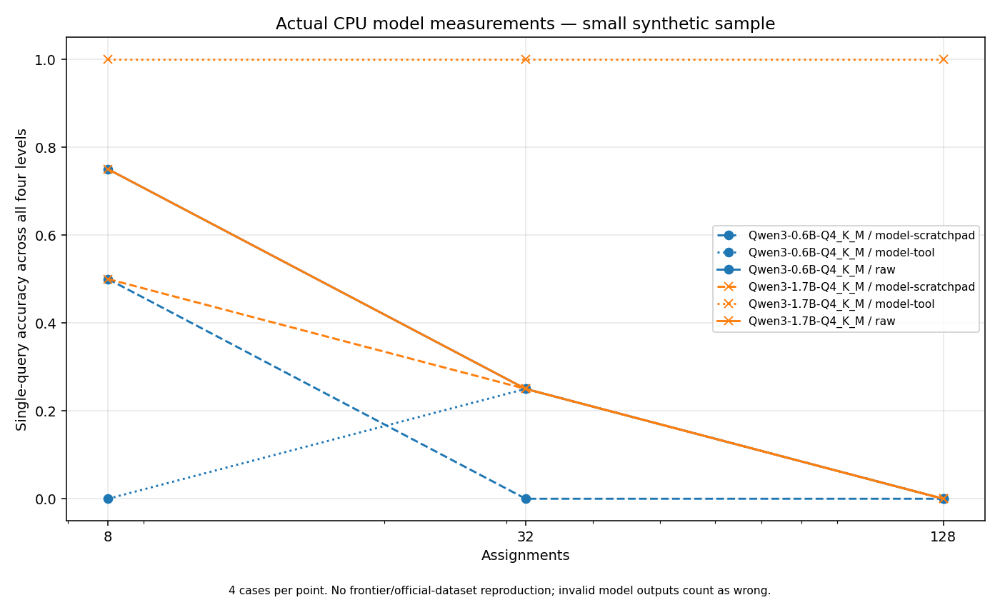

# Four-project build report

All four MVPs now include working code and verified demos. Real Qwen3 CPU inference replaces the initial model-unavailable gap; the earlier deterministic controls remain separately labeled. Every project ships PLAN.md, README.md, .env.example and a 60-second demo.

## Setup and exact commands

Provision the free local CPU endpoint using [MODEL_RUNS.md](../MODEL_RUNS.md). It downloads pinned, checksum-verified Qwen3 0.6B/1.7B Q4 models. Run one server with both aliases on port 8090; commands below start in `prototype-lab/`. No GPU or paid API is needed. For your RTX 5070 Ti with 16GB, project READMEs retain conservative Qwen3 4B/8B Q4 Ollama instructions; GPU memory was not measured.

**Fog Map — three real independent persona calls:**

```sh
(cd projects/fog-map && OPENAI_API_KEY=local OPENAI_BASE_URL=http://127.0.0.1:8090/v1 FOG_MODEL=Qwen3-1.7B-Q4_K_M python fog.py sample-spec.md --backend api --out output-reproduced)
```

The committed [live report](fog-map/output-live-1.7b/report.html) contains six ranked line/topic findings across five topics, including four definite policy conflicts. Three actual calls used 2,876 tokens: 1,444 input and 1,432 output. Failed smaller-model and interrupted runtime attempts are retained. Textual comparison can overflag paraphrases, and endpoint sketches omit HTTP methods.

**DynaFlow-style orchestrator — published-question benchmark:**

```sh
(cd projects/dynaflow-orchestrator && OPENAI_BASE_URL=http://127.0.0.1:8090/v1 python orchestrator.py --backend openai --model Qwen3-0.6B-Q4_K_M --tasks benchmark_tasks.json --max-tokens 256 --plan-max-tokens 256 --timeout 600 --input-per-million 0 --output-per-million 0 --output results-reproduced)
(cd projects/dynaflow-orchestrator && python regrade.py results-reproduced/results.json --tasks benchmark_tasks.json)
```

The lead generates constrained executable Python coordination programs; frozen calls pass full task context and prior outputs. The benchmark bundles the first six AIME 2024 and six HotpotQA distractor validation records with source IDs and provenance. Normalization of explicit answer wrappers is uniform and label-independent; original derived scores and every raw response remain available.

|Published subset|Arm|Correct|Tokens including unsolved calls|Tokens / solved|Invalid plans|
|---|---|---:|---:|---:|---:|
|aime2024|solo|0/6|1,676|undefined|0|
|aime2024|fixed|0/6|9,481|undefined|0|
|aime2024|generated|0/6|7,660|undefined|0|
|hotpotqa|solo|0/6|9,612|undefined|0|
|hotpotqa|fixed|1/6|29,744|29,744.0|0|
|hotpotqa|generated|0/6|26,601|undefined|3|

This weak small-model run has a floor effect: it establishes no orchestrator advantage. It completed 87 provider calls and 84,774 actual tokenizer-counted tokens with zero provider errors. Invalid programs are model/orchestration failures, not infrastructure failures. API fees total $0; fee per solved task is $0 where at least one is solved and undefined otherwise. Hardware, energy and cloud execution are excluded.

A separate real-model calibration uses the original twelve easy toy examples, with 128 solver tokens and 192 planner tokens rather than the published run’s 256/256. It does not replace the published subset or share its denominator:

|Calibration family|Arm|Correct|Actual tokens / solved|
|---|---|---:|---:|
|math|solo|1/6|1,039.0|
|math|fixed|1/6|4,875.0|
|math|generated|1/6|3,257.0|
|multihop|solo|4/6|292.0|
|multihop|fixed|4/6|1,060.5|
|multihop|generated|1/6|2,915.0|

Generated workflows lose token efficiency versus solo by 3.13× on calibration math and 9.98× on multi-hop. All failed-task and invalid-plan tokens are included. Local API fees remain $0. See [DynaFlow README](dynaflow-orchestrator/README.md) for calibration reproduction, complete tables, output limits and audit artifacts.

[DynaFlow’s paper](https://arxiv.org/abs/2610.34467) reports trained Qwen3.5-27B Forced-mode accuracy of 88.08% versus 77.18% overall and 100% on three AIME years. Its solo CoT AIME 2026 score is 86.67%, correcting the brief’s roughly 52%. Our small untrained CPU experiment does not confirm or refute those headline numbers.

**Pop-Up Optimizer — interactive offline Dallas map:**

```sh
python projects/popup-optimizer/app.py --port 8003
```

Open http://127.0.0.1:8003. The five-stop default covers 96,805 of 269,985 synthetic residents, counting overlaps once. Three services, stop counts and travel windows work. Demographics and clinic flags are invented, coordinates approximate, the map schematic and travel times heuristic; points are not validated venues. A standalone static snapshot is also bundled.

**StateBench-style harness — two real models plus memory/tool fixes:**

```sh
(cd projects/statebench-harness && python live_experiment.py --base-url http://127.0.0.1:8090/v1 --model Qwen3-0.6B-Q4_K_M --context 8192 --max-tokens 256 --raw-max-tokens 64 --lengths 8 32 128 --samples 1 --chunk-size 8 --timeout 600 --output results-qwen06)
(cd projects/statebench-harness && python live_experiment.py --base-url http://127.0.0.1:8090/v1 --model Qwen3-1.7B-Q4_K_M --context 8192 --max-tokens 256 --raw-max-tokens 64 --lengths 8 32 128 --samples 1 --chunk-size 8 --timeout 600 --output results-qwen17)
(cd projects/statebench-harness && python summarize_live.py results-qwen06 results-qwen17 --output results-models)
```

|CPU model|Assignments|Raw accuracy|Model-written state|Model-delegated execution tool|
|---|---:|---:|---:|---:|
|Qwen3-0.6B-Q4_K_M|8|75%|50%|0%|
|Qwen3-0.6B-Q4_K_M|32|25%|0%|25%|
|Qwen3-0.6B-Q4_K_M|128|0%|0%|0%|
|Qwen3-1.7B-Q4_K_M|8|75%|50%|100%|
|Qwen3-1.7B-Q4_K_M|32|25%|25%|100%|
|Qwen3-1.7B-Q4_K_M|128|0%|0%|100%|

Each point contains only four cases: one per difficulty level, fixed seed 42 and one queried variable. All 72 task/method records are complete, use identical paired input files across models and have zero transport/context errors. There were 171 actual model calls. Small samples and structured-output failures limit interpretation.

Model-written JSON state did not improve the baseline here. The 1.7B model’s execution-tool method recovered 100 percentage points at 128 assignments; the 0.6B model often failed the tool-call protocol. Tool delegation explicitly offloads computation to a deterministic interpreter that persists input-program state, then requires the model to read the answer. It does not demonstrate improved intrinsic tracking, and no expected answer is supplied to repair model state.



Generation and exact semantics are tested through 64,000 assignments; live inference was measured at 8, 32 and 128, with exact context-budget refusal rather than silent truncation. These synthetic tasks are not the official StateBench dataset. The [paper](https://arxiv.org/abs/2611.03094) studies different scales and metrics; the brief’s frontier 13% figure was not independently confirmed in searchable text. No frontier model, Gated DeltaNet/recurrent hybrid, paper training or GPU memory result is claimed. [Protocol, costs and evidence](statebench-harness/LIVE.md).

## Verification and remaining limits

Fresh source-only copies pass 27 unit tests and the documented CLI/optimizer smoke checks without models or GPUs. The portfolio production build passes and its checker validates 495 internal links on 35 pages. Browser verification covers Dallas controls, map links, a 390px mobile viewport, the actual Fog report and the standalone snapshot. The managed browser disallowed file:// navigation; standalone content was tested with zero network requests. Model provenance includes pinned revisions, file sizes and SHA-256; the adapter’s context guard and model switching were exercised.

The shipped research deliverable is the actual small-model core experiment, including negative results, not an independent replication of either paper’s headline score. Native Ollama 4B/8B GPU deployment remains a documented target, not measured hardware. The recurrent hybrid is an unimplemented stretch goal. Per-project READMEs contain setup, exact demos, measurements and limitations. No real secrets are included.
