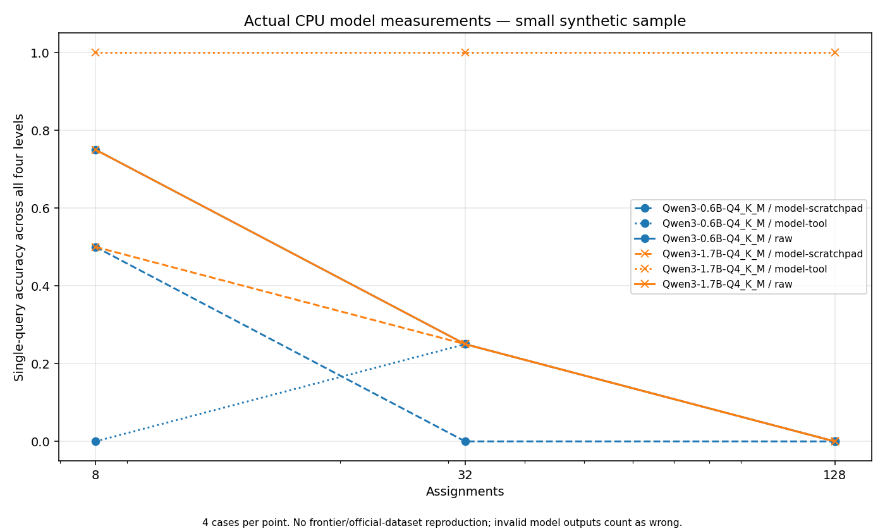

# Actual two-model measurements

CPU inference with pinned Qwen3 0.6B/1.7B Q4 GGUF models substitutes for the larger
4B/8B Q4 local GPU target. Task seed 42, four levels, four initial variables,
lengths 8/32/128, one case per level/length: **four cases per aggregate point**.
Temperature zero, no thinking, no JSON grammar; raw/tool answers have 64 output
tokens, model-written state 256. Invalid model output is incorrect; transport
or context errors are separate. See [LIVE.md](LIVE.md) for exact commands and
[model provenance](../../model_sources.json) for weight hashes.

## Accuracy

|Model (Q4)|Method|8 assignments|32 assignments|128 assignments|Overall|
|---|---|---:|---:|---:|---:|
|Qwen3-0.6B|Raw|3/4 (75.0%)|1/4 (25.0%)|0/4 (0.0%)|4/12 (33.3%)|
|Qwen3-0.6B|Model-written JSON state|2/4 (50.0%)|0/4 (0.0%)|0/4 (0.0%)|2/12 (16.7%)|
|Qwen3-0.6B|Model-delegated exact tool|0/4 (0.0%)|1/4 (25.0%)|0/4 (0.0%)|1/12 (8.3%)|
|Qwen3-1.7B|Raw|3/4 (75.0%)|1/4 (25.0%)|0/4 (0.0%)|4/12 (33.3%)|
|Qwen3-1.7B|Model-written JSON state|2/4 (50.0%)|1/4 (25.0%)|0/4 (0.0%)|3/12 (25.0%)|
|Qwen3-1.7B|Model-delegated exact tool|4/4 (100.0%)|4/4 (100.0%)|4/4 (100.0%)|12/12 (100.0%)|

Both raw models scored 75%, 25%, then 0% as length increased. Model-written state
did not improve either model's aggregate accuracy. The model-tool arm recovered
100 percentage points for 1.7B at 128 assignments, but the 0.6B model solved only
one of its 12 tool cases: eight tool requests and three final answers failed
the required JSON contract. Tool availability alone did not ensure reliable use.

The tool arm delegates all state updates to a disclosed deterministic interpreter;
the model requests the tool and reads its output. This is a practical tool fix,
not improved internal state tracking or evidence about recurrent architectures.
An ordinary interpreter alone already solves these formal inputs perfectly;
this arm measures successful delegation and reading, not a new tracking algorithm.

## Calls and tokens

|Model|Method|LLM calls|Input tokens|Output tokens|
|---|---|---:|---:|---:|
|Qwen3-0.6B|Raw|12|6208|88|
|Qwen3-0.6B|Model-written JSON state|52|13603|1615|
|Qwen3-0.6B|Model-delegated exact tool|16|6810|398|
|Qwen3-1.7B|Raw|12|6208|87|
|Qwen3-1.7B|Model-written JSON state|55|14686|1960|
|Qwen3-1.7B|Model-delegated exact tool|24|8133|160|

There were 171 actual LLM calls, 55,648 input tokens and 4,308 output tokens.
No transport/context errors occurred. Five 0.6B and four 1.7B model-written-state
cases failed the state schema; these count as incorrect. Exact prompts, responses,
finish reasons, usage and predictions are in each run's `records.json` and the
combined `results-models/records.json`. Per-level results are in
`results-models/results.md`; aggregate cost/count rows are in
`results-models/summary.md`. Elapsed wall times include shared-server queuing
and should not be interpreted as isolated model speed. No paid API was used.

## Paper comparison and limits

The brief cites frontier accuracy of at most 13% on the longest/hardest official
StateBench tasks. Its exact 13% was not independently confirmed in searchable
paper text. Our short synthetic tasks, small quantized models and single-query
metric are different: 0% at 128 assignments does **not** reproduce that frontier
percentage or establish a theoretical transformer ceiling. Errors can include
arithmetic, output-schema compliance and tool-use failures, not just memory.

Both generators support 8–64,000 assignments and tests exercise all four levels
at 64K. Actual inference here covers only 8–128. No silent truncation is counted
as cognitive failure. No frontier API, official benchmark dataset, trained
Gated DeltaNet or recurrent hybrid is included. The experiment is a reproducible
small-model smoke measurement, not a statistically precise independent paper
reproduction. The interrupted generic-grammar attempt is preserved separately
and excluded from final measurements. No result is fabricated.
