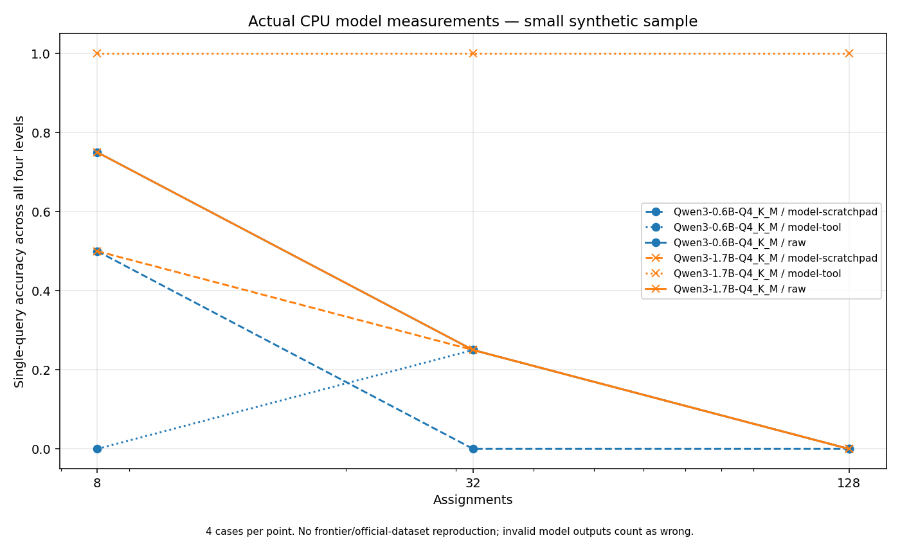

# StateBench-style state-tracking harness

A runnable synthetic assignment-chain benchmark with exact reference semantics,
Ollama/OpenAI-compatible model adapters, JSON scratchpad and chunked state tools,
per-example evidence, tables and PNG failure curves. Runs without a GPU.

**Research scope:** this is a synthetic StateBench-style test, not a reproduction
of the official dataset or a frontier-model result. The actual-model experiment
uses Qwen3 0.6B/1.7B Q4 CPU substitutions and measures raw predictions,
model-produced JSON state, and a separately labeled model-delegated execution
tool. See [LIVE.md](LIVE.md) for the protocol and commands. Original bounded CPU
replay controls remain below and are **not language model results**.

Paper: [A Fine-Grained Hierarchy and Benchmark for State Tracking in Language
Models / StateBench](https://arxiv.org/abs/2611.03094). The brief cites a frontier
ceiling of 13% on hardest/longest tasks. The coordinator retrieved the paper and
confirmed the topic, but the precise 13% was not confirmed in searchable text.
This generator is inspired by its topic, not its official dataset, complexity
hierarchy, or training protocol. Persistent aliasing here is an explicit design
choice; it should not be equated to the paper's reference-assignment definitions.
No Gated DeltaNet training or hybrid recurrent model has been implemented.

## Actual model driver

See [MEASUREMENTS.md](MEASUREMENTS.md) for actual scores and
[LIVE.md](LIVE.md) for the two-model CPU experiment, model-produced JSON
state and model-delegated tool fixes, exact commands and protocol limits.
The original CPU control artifacts below remain available separately.

|Model (Q4)|Method|8 assignments|32 assignments|128 assignments|Overall|
|---|---|---:|---:|---:|---:|
|Qwen3-0.6B|Raw|3/4 (75.0%)|1/4 (25.0%)|0/4 (0.0%)|4/12 (33.3%)|
|Qwen3-0.6B|Model-written JSON state|2/4 (50.0%)|0/4 (0.0%)|0/4 (0.0%)|2/12 (16.7%)|
|Qwen3-0.6B|Model-delegated exact tool|0/4 (0.0%)|1/4 (25.0%)|0/4 (0.0%)|1/12 (8.3%)|
|Qwen3-1.7B|Raw|3/4 (75.0%)|1/4 (25.0%)|0/4 (0.0%)|4/12 (33.3%)|
|Qwen3-1.7B|Model-written JSON state|2/4 (50.0%)|1/4 (25.0%)|0/4 (0.0%)|3/12 (25.0%)|
|Qwen3-1.7B|Model-delegated exact tool|4/4 (100.0%)|4/4 (100.0%)|4/4 (100.0%)|12/12 (100.0%)|

Each length has four synthetic cases per model. Both raw curves fall to 0% at
128 assignments. The 1.7B execution-tool arm recovers to 100%; the 0.6B model
frequently fails the tool protocol. Model-written state does not improve either
model overall. This is a small CPU-model experiment, not the paper's frontier
13% result or a proof of a transformer ceiling.



For a 60-second model demo, open the combined chart and
`results-models/summary.md`, inspect a prediction's `trace` in `records.json`,
then run `python -m unittest test_live_experiment -v`. The full live rerun commands
and deployment setup are in [LIVE.md](LIVE.md).
Rebuild the two-model charts from the shipped measured records without inference:

```bash
python summarize_live.py results-qwen06 results-qwen17 --output results-models
```


## Setup and offline measurement

From this directory, Python 3.10+:

```bash
python -m venv .venv
. .venv/bin/activate
pip install -r requirements.txt
python -m unittest -v
python harness.py --backend offline --output results
```

If matplotlib is already installed, only the last two commands are needed.
Offline runs use no network, keys or paid service. Dependencies need installation
once. Output is `results/accuracy.png`, `results/results.md`, `records.json` and
`config.json`. Every record includes truth, prediction, errors and runtime.

Measured defaults: seeds 42–44, 4 levels, 3 cases per level/length. Each table cell
below aggregates 12 examples; level-specific results are in `results/results.md`.

|Assignments|Replay last 32|Replay last 128|JSON scratchpad tool|Chunked tool|
|---:|---:|---:|---:|---:|
|8|100%|100%|100%|100%|
|32|100%|100%|100%|100%|
|128|25%|100%|100%|100%|
|512|16.7%|58.3%|100%|100%|
|2048|0%|50%|100%|100%|

Both exact tools tie at 100%, recovering 100 percentage points over replay-32 at
2048. This is expected: the tools execute the known formal language correctly.
It does not show that an LLM can reliably invoke or maintain a scratchpad. The
replay controls replay only a suffix and skip operations with missing inputs;
their windows were deliberately fixed to 32 and 128. These are diagnostic controls,
not approximations of actual model context capacity. Accuracy is exact equality
of the entire queried state, with no tolerance or partial credit. Samples are
small and no statistical significance is claimed.

## Live local model experiment (16GB target)

Install Ollama separately, then run one model at a time; the driver does not
load both simultaneously (requests use `keep_alive: 0` to unload after each call):

```bash
ollama pull qwen3:4b
ollama pull qwen3:8b
OLLAMA_NUM_CTX=8192 python harness.py --backend ollama --models qwen3:4b,qwen3:8b --lengths 8 32 128 512 --samples 3 --output results-live
```

Check `ollama show` to confirm Q4 quantization. Start with 4B Q4, then 8B Q4;
both are targets for a 16GB RTX 5070 Ti with a modest context. Budget KV cache
and runtime overhead; 64K assignments are **not** expected to fit this context
or VRAM. Longer contexts require explicit memory measurement and configuration.
The driver rejects prompts whose UTF-8 byte count plus a 2048-token reserve
exceeds the configured context. This conservative bound prevents silent input
truncation; rejected cases are context-limit errors, never cognitive failures.
Some 512-assignment cases will be skipped at 8192 context; increase context only
within the hardware budget. Smaller cases run at the default setting.
No 24GB GPU assumption, no 27B default. CPU Ollama also works, slowly.

Optional paid API (key only from environment; `.env.example` is documentation,
not automatically loaded):

```bash
export OPENAI_API_KEY='your-key'
export OPENAI_BASE_URL='https://api.openai.com/v1'
python harness.py --backend openai --models YOUR_MODEL --lengths 8 32 128 512 --output results-api
```

API context limits and model-specific chat options vary. Calls failing from
context limits, missing credentials, incompatible options, or transport errors
are logged as errors and excluded from accuracy denominators; see the separate
error counts. Invalid JSON from a successful call counts as incorrect. Token
usage is preserved where returned. The tool-fix rows are still deterministic
execution upper bounds, not model results, even in live runs.

## Semantics, scaling and reproduction

- **immutable:** each assignment creates a fresh variable; copies snapshot the
  current integer; query the last four variables.
- **overwrite:** eight variables; updates and value copies; query all eight.
- **self:** adds self-referential increments; integer arithmetic, no overflow.
- **reference:** adds persistent shared cells and simultaneous binding swaps.
  `ref(x,y)` aliases their cells; `set(x,5)` then also changes any alias of x.
  `copy(x,y)` copies a numeric value into x's existing cell.

Every generated chain has exactly the requested assignment count and a seed.
First eight assignments initialize eight names in the last three levels.
Scratchpad reloads and persists full JSON state each step; chunking serializes
and reloads state at boundaries before executing the next chunk. Neither tool
sees the expected answer. Full-state persistence is intentionally expensive for
immutable chains with many variables. To exercise up to 64,000 assignments
without repeatedly serializing the growing immutable state every step:

```bash
python harness.py --lengths 8 128 2048 64000 --samples 1 --fixes chunked --output results-long
```

Tests exercise all four levels at 64K and check aliases/swaps by hand. The immutable generator has one initial integer and later copies, so its
queries share that integer; it is a dependency-retention control, not rich
arithmetic. The
synthetic chain distribution can erase dependencies through later writes, so
neither control nor genuine model accuracy need decrease monotonically.

## 60-second CPU control demo

1. Open shipped `results/accuracy.png`: the title explicitly says CPU controls.
2. Show `results/results.md` and the table above: replay fails; exact tools recover.
3. Run `python harness.py --lengths 8 32 128 --samples 1 --output demo-results`.
4. Inspect `demo-results/records.json` for predictions and exact expected states.
5. Explain that these are CPU controls. For actual Qwen3 model measurements and
   the model-produced/model-delegated fixes, use the separate [live demo](LIVE.md).
